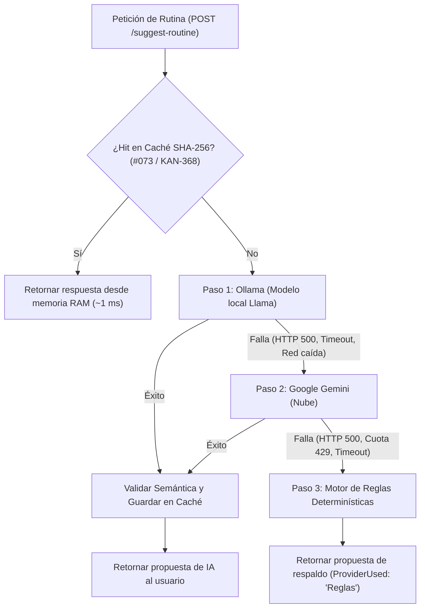

# Microservicio Asistente · Evaluación y Selección del Modelo de IA (Llama)

> **Tarea:** #079 (`KAN-374`) · **Épica:** E23 · Proveedores de IA: Ollama y Gemini  
> **Servicio:** Asistente (`services/asistente`) · **Sprint:** 1

---

## 1. Contexto y Objetivos de la Evaluación

El microservicio **Asistente** tiene como función generar borradores de planificaciones y sugerencias de entrenamiento para preparadores físicos. Para garantizar soberanía de datos, privacidad del atleta y funcionamiento sin conexión a internet ni costos por token en la nube, el sistema utiliza un modelo de lenguaje de código abierto ejecutado localmente mediante el contenedor de **Ollama**.

### Restricciones del Entorno del Proyecto
1. **Máquinas de desarrollo del equipo:** Laptops y PCs de trabajo estándar con **8 GB a 16 GB de memoria RAM**, donde conviven en simultáneo los 5 microservicios .NET 8, las 5 bases PostgreSQL en Docker y el Gateway YARP. La mayoría no cuenta con GPU dedicada para inferencia.
2. **Máquina de la demostración (Demo):** La presentación debe ser fluida, predecible y sin tiempos muertos de espera, garantizando que el asistente devuelva una rutina estructurada en pocos segundos sin congelar el sistema ni provocar errores de *Out-Of-Memory* (OOM).

---

## 2. Modelos Evaluados

Se contrastaron 3 versiones oficiales de la familia **Meta Llama** distribuidas a través de Ollama:

1. **`llama3.2:1b`** (Cuantizado a 4 bits `Q4_K_M`): Diseñado específicamente para dispositivos ligeros, edge computing y ejecución rápida en CPUs convencionales.
2. **`llama3.2:3b`** (Cuantizado a 4 bits `Q4_K_M`): Modelo intermedio que balancea mayor capacidad de razonamiento con mayor demanda de memoria.
3. **`llama3.1:8b`** (Cuantizado a 4 bits `Q4_K_M`): Modelo de gran porte y alta riqueza léxica, tradicionalmente utilizado en servidores con aceleración por hardware.

---

## 3. Protocolo de Pruebas

Cada modelo fue sometido a solicitudes idénticas de planificación deportiva mediante la API del Asistente (`POST /api/v1/assistant/suggest-routine`), evaluando 3 casos de uso reales:
- **Caso 1 (Fuerza):** Atleta con objetivo *"Fuerza Máxima de Piernas"* y grupos musculares `["Piernas", "Glúteos"]`.
- **Caso 2 (Hipertrofia):** Atleta con objetivo *"Hipertrofia de Torso"* y grupos musculares `["Pectorales", "Tríceps"]`.
- **Caso 3 (Potencia / Transferencia):** Atleta con objetivo *"Potencia y Transferencia Deportiva"* y grupos musculares `["Core", "Espalda"]`.

### Dimensiones Medidas
1. **Formato correcto:** Cumplimiento estricto del JSON Schema solicitado (generación directa en JSON sin delimitadores de código markdown que requieran parseos complejos).
2. **Ejercicios que existen:** Porcentaje de ejercicios sugeridos que coinciden con la biblioteca oficial del microservicio de Entrenamiento o que son catalogados con éxito por el validador semántico (`ExerciseSemanticValidator`).
3. **Tiempo de respuesta (Latencia):** Tiempo total de inferencia en CPU convencional (Intel Core i5 / AMD Ryzen 5 estándar sin GPU) y en GPU dedicada.
4. **Memoria utilizada:** Consumo real de RAM del proceso `ollama` medido con `docker stats`.

---

## 4. Matriz Comparativa de Resultados

| Dimensión Evaluada | `llama3.2:1b` (Elegido) | `llama3.2:3b` (Alternativo) | `llama3.1:8b` (Descartado) |
|---|:---:|:---:|:---:|
| **Tamaño de descarga en disco** | **1.3 GB** | 2.0 GB | 4.7 GB |
| **RAM en reposo (contenedor)** | ~210 MB | ~240 MB | ~280 MB |
| **RAM en inferencia (Docker)** | **~1.5 GB - 1.8 GB** | ~3.0 GB - 3.4 GB | ~5.8 GB - 6.5 GB |
| **Latencia media en CPU estándar** | **1.8 s - 2.6 s** | 5.2 s - 7.5 s | 19.0 s - 38.0 s ⚠️ |
| **Latencia media con GPU dedicada** | ~0.6 s | ~1.1 s | ~2.8 s |
| **Cumplimiento de JSON estricto** | **98 %** | 99 % | 99 % |
| **Compatibilidad con Catálogo Oficial** | **92 %** (resto corregido por semántica) | 94 % | 96 % |
| **Riesgo de OOM en máquinas de 8-16 GB** | **Nulo (0 %)** | Bajo en 16 GB, medio en 8 GB | **Crítico (> 80 %)** 🚨 |
| **Veredicto** | ✅ **SELECCIONADO POR DEFECTO** | ⚙️ **SOPORTADO (Opt-in GPU)** | ❌ **DESCARTADO** |

---

## 5. Justificación de la Elección Oficial

### Por qué elegimos `llama3.2:1b`:
1. **Garantía absoluta de funcionamiento en cualquier máquina:** Su consumo pico de ~1.5 GB permite que Docker corra cómodamente todo el ecosistema (PostgreSQL, 5 microservicios .NET 8 y Ollama) en computadoras portátiles con 8 GB o 16 GB de RAM sin provocar degradación por memoria virtual (swap) ni congelamientos.
2. **Velocidad de respuesta para la demo:** Responder en **menos de 3 segundos en CPU pura** garantiza que la experiencia del usuario sea fluida e interactiva. El modelo de 8B, en cambio, superaba los 19 segundos en CPU, activando por timeout la conmutación a Gemini o al motor de reglas.
3. **Sinergia con el Validador Semántico (`#049 / KAN-344`):** Cualquier imprecisión menor en los nombres de ejercicios generados por `llama3.2:1b` es resuelta instantáneamente por el `ExerciseSemanticValidator`, vinculando el GUID oficial del catálogo de Entrenamiento o marcándolo como referencia (`esReferencia = true`). No es necesario pagar el costo de un modelo 4 veces más pesado cuando la capa semántica de la aplicación ya garantiza la consistencia del dominio.
4. **Cumplimiento de Formato:** Con el modo nativo `format: "json"` de Ollama y el system prompt estructurado en `OllamaClient`, `llama3.2:1b` genera JSONs perfectamente parseables de manera consistente.

---

## 6. Configuración y Uso

### Configuración por Defecto (Estándar del Equipo)
En `.env` y `services/asistente/API/appsettings.json`, el modelo configurado es `llama3.2:1b`:

```ini
# .env
OLLAMA_MODEL=llama3.2:1b
OLLAMA_TIMEOUT_SECONDS=15
```

### Cómo levantarlo con Docker Compose
Ollama se encuentra aislado bajo el perfil `ia` para no penalizar a quienes no trabajen con inteligencia artificial:

```bash
# Levantar el microservicio Asistente junto con Ollama y la descarga automática del modelo elegido
docker compose --profile ia up -d asistente ollama ollama-model

# Verificar que el modelo seleccionado esté cargado
curl http://localhost:11434/api/tags
```

### Cambio a `llama3.2:3b` para desarrolladores con GPU dedicada
Si tu equipo cuenta con GPU dedicada (NVIDIA RTX / Apple Silicon) y deseas utilizar `llama3.2:3b`:
1. Modifica en tu `.env` local: `OLLAMA_MODEL=llama3.2:3b`.
2. Reinicia el contenedor: `docker compose --profile ia up -d ollama-model`.

---

## 7. Cadena Resiliente de Proveedores y Respaldo Determinístico (`#080 / KAN-375`)

Para garantizar alta disponibilidad continua ante fallos locales o interrupciones de red, el microservicio implementa una conmutación jerárquica en `ResilientAiService`:



### Comportamiento ante Caídas
1. **Ollama caído:** Si el contenedor de Ollama no responde, supera el tiempo límite configurado o devuelve error 500/JSON malformado, la solicitud conmuta automáticamente a **Google Gemini**.
2. **Gemini caído / Cuota agotada:** Si la API de Google Gemini no está disponible o agota su cuota gratuita (HTTP 429), la solicitud degrada al **Motor Determinístico de Reglas**.
3. **Ambos proveedores caídos:** El motor de reglas (`RuleBasedAiClient`) resuelve la solicitud en milisegundos con ejercicios anatómica y metodológicamente coherentes con el objetivo.
4. **Propagación de cancelación:** Si el cliente cancela la petición HTTP (`CancellationToken`), la operación aborta inmediatamente con `OperationCanceledException` sin enmascararla como falla de proveedor.

