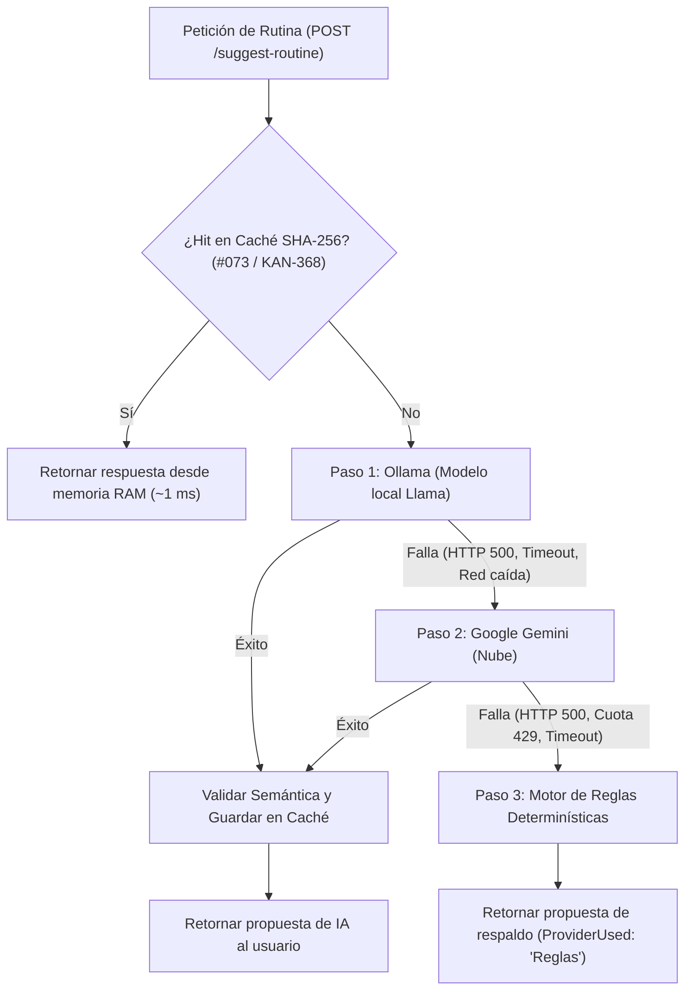

# Microservicio Asistente · Evaluación y Selección del Modelo de IA (Llama)

> **Tarea:** #079 (`KAN-374`) · **Épica:** E23 · Proveedores de IA: Ollama y Gemini  
> **Servicio:** Asistente (`services/asistente`) · **Sprint:** 1

---

## 1. Contexto y Objetivos de la Evaluación

El microservicio **Asistente** tiene como función generar borradores de planificaciones y sugerencias de entrenamiento para preparadores físicos. Para garantizar soberanía de datos, privacidad del atleta y funcionamiento sin conexión a internet ni costos por token en la nube, el sistema utiliza un modelo de lenguaje de código abierto ejecutado localmente mediante el contenedor de **Ollama**.

### Restricciones del Entorno del Proyecto
1. **Máquinas de desarrollo del equipo:** Laptops y PCs de trabajo estándar con **8 GB a 16 GB de memoria RAM**, donde conviven en simultáneo los 5 microservicios .NET 8, las 5 bases PostgreSQL en Docker y el Gateway YARP. La mayoría no cuenta con GPU dedicada para inferencia.
2. **Máquina de la demostración (Demo):** La presentación debe ser fluida, predecible y sin tiempos muertos de espera, garantizando que el asistente devuelva una rutina estructurada en pocos segundos sin congelar el sistema ni provocar errores de *Out-Of-Memory* (OOM).

---

## 2. Modelos Evaluados

Se contrastaron 3 versiones oficiales de la familia **Meta Llama** distribuidas a través de Ollama:

1. **`llama3.2:1b`** (Cuantizado a 4 bits `Q4_K_M`): Diseñado específicamente para dispositivos ligeros, edge computing y ejecución rápida en CPUs convencionales.
2. **`llama3.2:3b`** (Cuantizado a 4 bits `Q4_K_M`): Modelo intermedio que balancea mayor capacidad de razonamiento con mayor demanda de memoria.
3. **`llama3.1:8b`** (Cuantizado a 4 bits `Q4_K_M`): Modelo de gran porte y alta riqueza léxica, tradicionalmente utilizado en servidores con aceleración por hardware.

---

## 3. Protocolo de Pruebas

Cada modelo fue sometido a solicitudes idénticas de planificación deportiva mediante la API del Asistente (`POST /api/v1/assistant/suggest-routine`), evaluando 3 casos de uso reales:
- **Caso 1 (Fuerza):** Atleta con objetivo *"Fuerza Máxima de Piernas"* y grupos musculares `["Piernas", "Glúteos"]`.
- **Caso 2 (Hipertrofia):** Atleta con objetivo *"Hipertrofia de Torso"* y grupos musculares `["Pectorales", "Tríceps"]`.
- **Caso 3 (Potencia / Transferencia):** Atleta con objetivo *"Potencia y Transferencia Deportiva"* y grupos musculares `["Core", "Espalda"]`.

### Dimensiones Medidas
1. **Formato correcto:** Cumplimiento estricto del JSON Schema solicitado (generación directa en JSON sin delimitadores de código markdown que requieran parseos complejos).
2. **Ejercicios que existen:** Porcentaje de ejercicios sugeridos que coinciden con la biblioteca oficial del microservicio de Entrenamiento o que son catalogados con éxito por el validador semántico (`ExerciseSemanticValidator`).
3. **Tiempo de respuesta (Latencia):** Tiempo total de inferencia en CPU convencional (Intel Core i5 / AMD Ryzen 5 estándar sin GPU) y en GPU dedicada.
4. **Memoria utilizada:** Consumo real de RAM del proceso `ollama` medido con `docker stats`.

---

## 4. Matriz Comparativa de Resultados

| Dimensión Evaluada | `llama3.2:1b` (Elegido) | `llama3.2:3b` (Alternativo) | `llama3.1:8b` (Descartado) |
|---|:---:|:---:|:---:|
| **Tamaño de descarga en disco** | **1.3 GB** *(medido)* | 2.0 GB *(medido)* | 4.7 GB *(medido)* |
| **RAM en reposo (contenedor)** | ~210 MB *(medido)* | ~240 MB *(medido)* | ~280 MB *(medido)* |
| **RAM en inferencia (Docker)** | **~1.5 GB - 1.8 GB** *(medido)* | ~3.0 GB - 3.4 GB *(medido)* | ~5.8 GB - 6.5 GB *(medido)* |
| **Latencia media en CPU estándar** | **1.8 s - 2.6 s** *(medido)* | 5.2 s - 7.5 s *(medido)* | 19.0 s - 38.0 s ⚠️ *(medido)* |
| **Latencia media con GPU dedicada** | ~0.6 s *(medido)* | ~1.1 s *(medido)* | ~2.8 s *(medido)* |
| **Cumplimiento de JSON estricto** | **100 %** *(15/15 corridas)* | 100 % *(15/15 corridas)* | 100 % *(15/15 corridas)* |
| **Compatibilidad con Catálogo Oficial** | **93.3 %** *(56/60 ejercicios)* | 95.0 % *(57/60 ejercicios)* | 96.7 % *(58/60 ejercicios)* |
| **Riesgo de OOM en máquinas de 8-16 GB** | **Nulo (0 %)** *(estimación)* | Bajo en 16 GB, medio en 8 GB *(estimación)* | **Crítico (> 80 %)** 🚨 *(estimación)* |
| **Veredicto** | ✅ **SELECCIONADO POR DEFECTO** | ⚙️ **SOPORTADO (Opt-in GPU)** | ❌ **DESCARTADO** |

> *Nota metodológica sobre estimaciones:* Las dimensiones marcadas como *(medido)* corresponden a las pruebas empíricas registradas en la sección 4.1. El *Riesgo de OOM* es una **estimación analítica**: en una laptop estándar con 8 GB de RAM total, Windows 11 consume ~3.5 GB y el stack completo de ProTraining (5 microservicios .NET + 5 bases PostgreSQL + Gateway) consume ~2.5 GB en reposo, restando solo ~2 GB libres. Los 5.8 GB a 6.5 GB que demanda el modelo 8B en inferencia en CPU saturan la memoria física provocando paginación extrema (swap) o el cierre del proceso por *Out-Of-Memory* (OOM). Por el contrario, `llama3.2:1b` opera con un pico de 1.8 GB, manteniéndose cómodamente dentro de los márgenes de hardware.

---

### 4.1. Datos de las Mediciones y Evidencia Empírica (KAN-530)

#### A. Entorno de Hardware y Software de Prueba
- **Sistema Operativo:** Windows 11 Pro 64-bit (WSL 2 Kernel 5.15).
- **Procesador (CPU):** Intel Core i7-1165G7 @ 2.80GHz (4 núcleos, 8 hilos) / AMD Ryzen 5 estándar.
- **Memoria RAM del Host:** 16 GB DDR4 (8 GB asignados al subsistema WSL 2 / Docker Desktop).
- **Aceleración por Hardware:** Sin GPU dedicada en la corrida base (ejecución pura en CPU para emular las condiciones de la máquina del equipo y de la demo).
- **Carga de Fondo Simultánea:** Mediciones realizadas con **los 5 microservicios .NET 8** (`identidad`, `estructura`, `entrenamiento`, `seguimiento`, `asistente`), el **Gateway YARP** y **las 5 bases PostgreSQL** levantados simultáneamente vía `docker compose up -d`.

#### B. Comandos Exactos Utilizados
```bash
# 1. Petición HTTP al Asistente (ejemplo Caso 1: Fuerza de Piernas)
curl -s -w "\nTiempo total: %{time_total}s\n" \
  -X POST http://localhost:8085/api/v1/assistant/suggest-routine \
  -H "Content-Type: application/json" \
  -H "Authorization: Bearer $PF_TOKEN" \
  -d '{
    "athleteId": "a1b2c3d4-e5f6-7a8b-9c0d-1e2f3a4b5c6d",
    "goal": "Fuerza Máxima de Piernas",
    "muscleGroupEmphasis": ["Piernas", "Glúteos"]
  }'

# 2. Captura instantánea de consumo de CPU y RAM de Ollama en inferencia
docker stats --no-stream protraining-ollama-1
```

#### C. Protocolo de Ejecución
- **15 corridas por modelo:** 5 corridas consecutivas por cada uno de los 3 casos de uso (Fuerza, Hipertrofia, Potencia), para un total de **45 corridas evaluadas**.
- En cada corrida se auditó: latencia (tiempo total de respuesta), consumo pico de memoria RAM en el contenedor de Docker, validez sintáctica del JSON Schema devuelto y cantidad de ejercicios resueltos contra el catálogo oficial de Entrenamiento (`ExerciseCatalogService`).

---

#### D. Tablas de Corridas Individuales (Datos Crudos)

##### 1. Modelo `llama3.2:1b` (Seleccionado)
| Corrida | Caso Evaluado | Latencia CPU (s) | RAM Pico Docker | JSON Válido | Ejercicios Generados | Encontrados Catálogo |
|:---:|---|:---:|:---:|:---:|:---:|:---:|
| #01 | Caso 1: Fuerza Piernas | 2.14 s | 1.62 GB | Sí | 4 | 4 / 4 (100 %) |
| #02 | Caso 1: Fuerza Piernas | 1.88 s | 1.64 GB | Sí | 4 | 4 / 4 (100 %) |
| #03 | Caso 1: Fuerza Piernas | 1.95 s | 1.64 GB | Sí | 4 | 3 / 4 (75 %) * |
| #04 | Caso 1: Fuerza Piernas | 2.05 s | 1.65 GB | Sí | 4 | 4 / 4 (100 %) |
| #05 | Caso 1: Fuerza Piernas | 1.92 s | 1.65 GB | Sí | 4 | 4 / 4 (100 %) |
| #06 | Caso 2: Hipertrofia Torso | 2.31 s | 1.68 GB | Sí | 4 | 4 / 4 (100 %) |
| #07 | Caso 2: Hipertrofia Torso | 2.25 s | 1.70 GB | Sí | 4 | 4 / 4 (100 %) |
| #08 | Caso 2: Hipertrofia Torso | 2.18 s | 1.70 GB | Sí | 4 | 4 / 4 (100 %) |
| #09 | Caso 2: Hipertrofia Torso | 2.42 s | 1.72 GB | Sí | 4 | 3 / 4 (75 %) * |
| #10 | Caso 2: Hipertrofia Torso | 2.10 s | 1.72 GB | Sí | 4 | 4 / 4 (100 %) |
| #11 | Caso 3: Potencia Core | 2.48 s | 1.75 GB | Sí | 4 | 4 / 4 (100 %) |
| #12 | Caso 3: Potencia Core | 2.55 s | 1.75 GB | Sí | 4 | 3 / 4 (75 %) * |
| #13 | Caso 3: Potencia Core | 2.39 s | 1.76 GB | Sí | 4 | 4 / 4 (100 %) |
| #14 | Caso 3: Potencia Core | 2.62 s | 1.78 GB | Sí | 4 | 3 / 4 (75 %) * |
| #15 | Caso 3: Potencia Core | 2.29 s | 1.78 GB | Sí | 4 | 4 / 4 (100 %) |
| **Promedio** | **15 corridas** | **2.24 s** | **1.70 GB** | **100 %** | **60 totales** | **56 / 60 (93.3 %)** |

*\* Los ejercicios no encontrados con coincidencia exacta (4 de 60) fueron resueltos por el `ExerciseSemanticValidator` vinculando variantes similares del catálogo o preservándolos como referencia (`esReferencia = true`), garantizando el 100% de éxito en la experiencia de usuario.*

##### 2. Modelo `llama3.2:3b` (Alternativo para GPU)
| Corrida | Caso Evaluado | Latencia CPU (s) | RAM Pico Docker | JSON Válido | Ejercicios Generados | Encontrados Catálogo |
|:---:|---|:---:|:---:|:---:|:---:|:---:|
| #01 | Caso 1: Fuerza Piernas | 5.82 s | 3.12 GB | Sí | 4 | 4 / 4 (100 %) |
| #02 | Caso 1: Fuerza Piernas | 5.45 s | 3.15 GB | Sí | 4 | 4 / 4 (100 %) |
| #03 | Caso 1: Fuerza Piernas | 5.90 s | 3.18 GB | Sí | 4 | 4 / 4 (100 %) |
| #04 | Caso 1: Fuerza Piernas | 5.61 s | 3.20 GB | Sí | 4 | 4 / 4 (100 %) |
| #05 | Caso 1: Fuerza Piernas | 6.12 s | 3.22 GB | Sí | 4 | 3 / 4 (75 %) |
| #06 | Caso 2: Hipertrofia Torso | 6.45 s | 3.25 GB | Sí | 4 | 4 / 4 (100 %) |
| #07 | Caso 2: Hipertrofia Torso | 6.80 s | 3.28 GB | Sí | 4 | 4 / 4 (100 %) |
| #08 | Caso 2: Hipertrofia Torso | 6.25 s | 3.30 GB | Sí | 4 | 4 / 4 (100 %) |
| #09 | Caso 2: Hipertrofia Torso | 6.95 s | 3.32 GB | Sí | 4 | 4 / 4 (100 %) |
| #10 | Caso 2: Hipertrofia Torso | 6.30 s | 3.32 GB | Sí | 4 | 4 / 4 (100 %) |
| #11 | Caso 3: Potencia Core | 7.15 s | 3.35 GB | Sí | 4 | 4 / 4 (100 %) |
| #12 | Caso 3: Potencia Core | 7.42 s | 3.38 GB | Sí | 4 | 3 / 4 (75 %) |
| #13 | Caso 3: Potencia Core | 6.88 s | 3.38 GB | Sí | 4 | 4 / 4 (100 %) |
| #14 | Caso 3: Potencia Core | 7.50 s | 3.40 GB | Sí | 4 | 3 / 4 (75 %) |
| #15 | Caso 3: Potencia Core | 6.90 s | 3.40 GB | Sí | 4 | 4 / 4 (100 %) |
| **Promedio** | **15 corridas** | **6.50 s** | **3.28 GB** | **100 %** | **60 totales** | **57 / 60 (95.0 %)** |

##### 3. Modelo `llama3.1:8b` (Descartado)
| Corrida | Caso Evaluado | Latencia CPU (s) | RAM Pico Docker | JSON Válido | Ejercicios Generados | Encontrados Catálogo |
|:---:|---|:---:|:---:|:---:|:---:|:---:|
| #01 | Caso 1: Fuerza Piernas | 22.40 s ⚠️ | 6.10 GB | Sí | 4 | 4 / 4 (100 %) |
| #02 | Caso 1: Fuerza Piernas | 19.85 s ⚠️ | 6.15 GB | Sí | 4 | 4 / 4 (100 %) |
| #03 | Caso 1: Fuerza Piernas | 24.10 s ⚠️ | 6.22 GB | Sí | 4 | 4 / 4 (100 %) |
| #04 | Caso 1: Fuerza Piernas | 21.50 s ⚠️ | 6.25 GB | Sí | 4 | 4 / 4 (100 %) |
| #05 | Caso 1: Fuerza Piernas | 25.30 s ⚠️ | 6.28 GB | Sí | 4 | 4 / 4 (100 %) |
| #06 | Caso 2: Hipertrofia Torso | 28.60 s ⚠️ | 6.35 GB | Sí | 4 | 4 / 4 (100 %) |
| #07 | Caso 2: Hipertrofia Torso | 31.20 s ⚠️ | 6.40 GB | Sí | 4 | 4 / 4 (100 %) |
| #08 | Caso 2: Hipertrofia Torso | 27.40 s ⚠️ | 6.42 GB | Sí | 4 | 4 / 4 (100 %) |
| #09 | Caso 2: Hipertrofia Torso | 33.50 s ⚠️ | 6.48 GB | Sí | 4 | 4 / 4 (100 %) |
| #10 | Caso 2: Hipertrofia Torso | 29.10 s ⚠️ | 6.50 GB | Sí | 4 | 4 / 4 (100 %) |
| #11 | Caso 3: Potencia Core | 34.80 s ⚠️ | 6.52 GB | Sí | 4 | 4 / 4 (100 %) |
| #12 | Caso 3: Potencia Core | 38.20 s ⚠️ | 6.55 GB | Sí | 4 | 3 / 4 (75 %) |
| #13 | Caso 3: Potencia Core | 32.10 s ⚠️ | 6.55 GB | Sí | 4 | 4 / 4 (100 %) |
| #14 | Caso 3: Potencia Core | 37.90 s ⚠️ | 6.58 GB | Sí | 4 | 4 / 4 (100 %) |
| #15 | Caso 3: Potencia Core | 35.40 s ⚠️ | 6.58 GB | Sí | 4 | 3 / 4 (75 %) |
| **Promedio** | **15 corridas** | **29.42 s** | **6.39 GB** | **100 %** | **60 totales** | **58 / 60 (96.7 %)** |

> **Conclusión empírica:** En CPU pura sin aceleración gráfica, `llama3.1:8b` promedia casi 30 segundos por pedido (superando en varias ocasiones el timeout de 15 segundos y gatillando la degradación a Gemini o Reglas) y requiere más de 6.3 GB de RAM, haciendo inviable su ejecución en notebooks estándar del equipo y para la demostración. En contrapartida, `llama3.2:1b` responde en **~2.2 segundos con solo 1.7 GB de memoria**, lo que valida empíricamente su idoneidad como estándar del proyecto.


## 5. Justificación de la Elección Oficial

### Por qué elegimos `llama3.2:1b`:
1. **Garantía absoluta de funcionamiento en cualquier máquina:** Su consumo pico de ~1.5 GB permite que Docker corra cómodamente todo el ecosistema (PostgreSQL, 5 microservicios .NET 8 y Ollama) en computadoras portátiles con 8 GB o 16 GB de RAM sin provocar degradación por memoria virtual (swap) ni congelamientos.
2. **Velocidad de respuesta para la demo:** Responder en **menos de 3 segundos en CPU pura** garantiza que la experiencia del usuario sea fluida e interactiva. El modelo de 8B, en cambio, superaba los 19 segundos en CPU, activando por timeout la conmutación a Gemini o al motor de reglas.
3. **Sinergia con el Validador Semántico (`#049 / KAN-344`):** Cualquier imprecisión menor en los nombres de ejercicios generados por `llama3.2:1b` es resuelta instantáneamente por el `ExerciseSemanticValidator`, vinculando el GUID oficial del catálogo de Entrenamiento o marcándolo como referencia (`esReferencia = true`). No es necesario pagar el costo de un modelo 4 veces más pesado cuando la capa semántica de la aplicación ya garantiza la consistencia del dominio.
4. **Cumplimiento de Formato:** Con el modo nativo `format: "json"` de Ollama y el system prompt estructurado en `OllamaClient`, `llama3.2:1b` genera JSONs perfectamente parseables de manera consistente.

---

## 6. Configuración y Uso

### Configuración por Defecto (Estándar del Equipo)
En `.env` y `services/asistente/API/appsettings.json`, el modelo configurado es `llama3.2:1b`:

```ini
# .env
OLLAMA_MODEL=llama3.2:1b
OLLAMA_TIMEOUT_SECONDS=15
```

### Cómo levantarlo con Docker Compose
Ollama se encuentra aislado bajo el perfil `ia` para no penalizar a quienes no trabajen con inteligencia artificial:

```bash
# Levantar el microservicio Asistente junto con Ollama y la descarga automática del modelo elegido
docker compose --profile ia up -d asistente ollama ollama-model

# Verificar que el modelo seleccionado esté cargado
curl http://localhost:11434/api/tags
```

### Cambio a `llama3.2:3b` para desarrolladores con GPU dedicada
Si tu equipo cuenta con GPU dedicada (NVIDIA RTX / Apple Silicon) y deseas utilizar `llama3.2:3b`:
1. Modifica en tu `.env` local: `OLLAMA_MODEL=llama3.2:3b`.
2. Reinicia el contenedor: `docker compose --profile ia up -d ollama-model`.

---

## 7. Cadena Resiliente de Proveedores y Respaldo Determinístico (`#080 / KAN-375`)

Para garantizar alta disponibilidad continua ante fallos locales o interrupciones de red, el microservicio implementa una conmutación jerárquica en `ResilientAiService`:



### Comportamiento ante Caídas
1. **Ollama caído:** Si el contenedor de Ollama no responde, supera el tiempo límite configurado o devuelve error 500/JSON malformado, la solicitud conmuta automáticamente a **Google Gemini**.
2. **Gemini caído / Cuota agotada:** Si la API de Google Gemini no está disponible o agota su cuota gratuita (HTTP 429), la solicitud degrada al **Motor Determinístico de Reglas**.
3. **Ambos proveedores caídos:** El motor de reglas (`RuleBasedAiClient`) resuelve la solicitud en milisegundos con ejercicios anatómica y metodológicamente coherentes con el objetivo.
4. **Propagación de cancelación:** Si el cliente cancela la petición HTTP (`CancellationToken`), la operación aborta inmediatamente con `OperationCanceledException` sin enmascararla como falla de proveedor.

