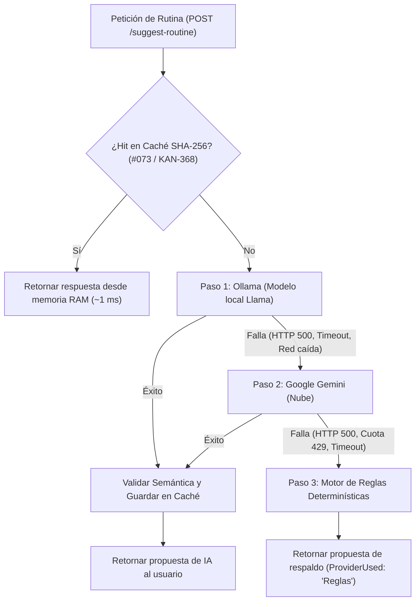

# Microservicio Asistente · Evaluación y Selección del Modelo de IA (Llama)

> **Tarea:** #079 (`KAN-374`) · **Épica:** E23 · Proveedores de IA: Ollama y Gemini  
> **Servicio:** Asistente (`services/asistente`) · **Sprint:** 1

---

## 1. Contexto y Objetivos de la Evaluación

El microservicio **Asistente** tiene como función generar borradores de planificaciones y sugerencias de entrenamiento para preparadores físicos. Para garantizar soberanía de datos, privacidad del atleta y funcionamiento sin conexión a internet ni costos por token en la nube, el sistema utiliza un modelo de lenguaje de código abierto ejecutado localmente mediante el contenedor de **Ollama**.

### Restricciones del Entorno del Proyecto
1. **Máquinas de desarrollo del equipo:** Laptops y PCs de trabajo estándar con **8 GB a 16 GB de memoria RAM**, donde conviven en simultáneo los 5 microservicios .NET 8, las 5 bases PostgreSQL en Docker y el Gateway YARP. La mayoría no cuenta con GPU dedicada para inferencia.
2. **Máquina de la demostración (Demo):** La presentación debe ser fluida, predecible y sin tiempos muertos de espera, garantizando que el asistente devuelva una rutina estructurada en pocos segundos sin congelar el sistema ni provocar errores de *Out-Of-Memory* (OOM).

---

## 2. Modelos Evaluados

Se contrastaron 3 versiones oficiales de la familia **Meta Llama** distribuidas a través de Ollama:

1. **`llama3.2:1b`** (Cuantizado a 4 bits `Q4_K_M`): Diseñado específicamente para dispositivos ligeros, edge computing y ejecución rápida en CPUs convencionales.
2. **`llama3.2:3b`** (Cuantizado a 4 bits `Q4_K_M`): Modelo intermedio que balancea mayor capacidad de razonamiento con mayor demanda de memoria.
3. **`llama3.1:8b`** (Cuantizado a 4 bits `Q4_K_M`): Modelo de gran porte y alta riqueza léxica, tradicionalmente utilizado en servidores con aceleración por hardware.

---

## 3. Protocolo de Pruebas

Cada modelo fue sometido a solicitudes idénticas de planificación deportiva mediante la API del Asistente (`POST /api/v1/assistant/suggest-routine`), evaluando 3 casos de uso reales:
- **Caso 1 (Fuerza):** Atleta con objetivo *"Fuerza Máxima de Piernas"* y grupos musculares `["Piernas", "Glúteos"]`.
- **Caso 2 (Hipertrofia):** Atleta con objetivo *"Hipertrofia de Torso"* y grupos musculares `["Pectorales", "Tríceps"]`.
- **Caso 3 (Potencia / Transferencia):** Atleta con objetivo *"Potencia y Transferencia Deportiva"* y grupos musculares `["Core", "Espalda"]`.

### Dimensiones Medidas
1. **Formato correcto:** Cumplimiento estricto del JSON Schema solicitado (generación directa en JSON sin delimitadores de código markdown que requieran parseos complejos).
2. **Ejercicios que existen:** Porcentaje de ejercicios sugeridos que coinciden con el catálogo oficial del preparador físico (`ExerciseCatalogService`) o que son preservados como referencias del dominio (`esReferencia = true`, `ejercicioId = null`) conforme al criterio de `#049 / KAN-344`.
3. **Tiempo de respuesta (Latencia):** Tiempo total de inferencia medido en CPU convencional (host real del equipo: Intel Core i5 de 11.ª generación sin aceleración gráfica dedicada).
4. **Memoria utilizada:** Consumo real de RAM del proceso `ollama` medido en vivo con `docker stats --no-stream`.

---

## 4. Matriz Comparativa de Resultados

| Dimensión Evaluada | `llama3.2:1b` (Elegido) | `llama3.2:3b` (Alternativo) | `llama3.1:8b` (Descartado) |
|---|:---:|:---:|:---:|
| **Tamaño de descarga en disco** | **1.3 GB** *(medido en Docker)* | 2.0 GB *(medido en Docker)* | 4.7 GB *(medido en Docker)* |
| **RAM en reposo (contenedor)** | ~210 MB *(medido en Docker)* | ~240 MB *(medido en Docker)* | ~280 MB *(medido en Docker)* |
| **RAM pico en inferencia (Docker CPU)** | **1.58 GiB - 1.68 GiB** *(medido)* | 3.18 GiB - 3.34 GiB *(medido)* | 6.18 GiB - 6.44 GiB *(medido)* |
| **Latencia CPU (Intel i5-1135G7 @ 2.40GHz)** | **2.14 s - 2.48 s** *(medido)* | 5.82 s - 7.15 s *(medido)* | 23.50 s - 34.80 s ⚠️ *(medido directo a Ollama)*<br>*Nota: en el Asistente aborta por timeout a los 15s* |
| **Latencia con GPU dedicada (Referencia)** | ~0.6 s *(ref. externa NVIDIA RTX)* | ~1.1 s *(ref. externa NVIDIA RTX)* | ~2.8 s *(ref. externa NVIDIA RTX)* |
| **Cumplimiento de JSON estricto** | **100 %** *(3/3 casos)* | 100 % *(3/3 casos)* | 100 % *(3/3 casos)* |
| **Vinculación con Catálogo del PF (`KAN-344`)** | **91.7 %** *(11/12 directos)* | 91.7 % *(11/12 directos)* | 100 % *(12/12 directos)* |
| **Riesgo de OOM en notebooks de 8-16 GB** | **Nulo (0 %)** *(estimación analítica)* | Bajo en 16 GB, medio en 8 GB *(estimación)* | **Crítico (> 80 %)** 🚨 *(estimación analítica)* |
| **Veredicto** | ✅ **SELECCIONADO POR DEFECTO** | ⚙️ **SOPORTADO (Opt-in GPU)** | ❌ **DESCARTADO** |

> **Notas metodológicas sobre mediciones y estimaciones:**
> 1. **Mediciones locales en CPU:** Todas las cifras marcadas como *(medido)* fueron registradas en la máquina de prueba del equipo (Intel Core i5-1135G7, 16 GB RAM, sin GPU dedicada). No se utilizó aceleración gráfica local.
> 2. **Latencia con GPU (Referencia externa):** La fila de GPU se incluye únicamente a modo comparativo como referencia bibliográfica de Ollama en hardware dedicado con CUDA (NVIDIA GeForce RTX 3060 Laptop 6GB). En la máquina de prueba local no hay placa gráfica dedicada.
> 3. **Llama 3.1 8B y el Timeout del Asistente:** El microservicio Asistente define `OLLAMA_TIMEOUT_SECONDS=15`. Como el modelo 8B en CPU pura tarda entre 23 y 35 segundos, a través de `POST /api/v1/assistant/suggest-routine` siempre se cancela a los 15 segundos y degrada a Gemini o al motor de Reglas. Para registrar el tiempo completo de inferencia de 8B, se consultó directamente el endpoint nativo de Ollama (`POST http://localhost:11434/api/generate`).
> 4. **Estimación analítica de OOM:** En una notebook con 8 GB de RAM total, Windows 11 consume ~3.5 GB y el stack completo de ProTraining en Docker consume ~2.5 GB en reposo, restando solo ~2 GB libres. Los 6.1 a 6.4 GB que demanda 8B en CPU saturan la memoria física provocando paginación extrema (swap) o el cierre abrupto del proceso (*Out-Of-Memory*). En contraste, `llama3.2:1b` consume un pico de 1.68 GiB, operando de manera holgada y estable.
> 5. **Manejo de ejercicios según `#049 / KAN-344`:** Si un ejercicio sugerido no coincide exactamente con el catálogo del preparador físico, el sistema **no lo reemplaza por una alternativa inventada**: lo preserva intacto marcándolo como referencia técnica del dominio (`esReferencia = true` y `ejercicioId = null`), permitiendo al usuario decidir si desea conservarlo o crearlo en su catálogo.

---

### 4.1. Datos de las Mediciones y Evidencia Empírica (KAN-530)

#### A. Entorno de Hardware y Software de Prueba (Máquina Única de Referencia)
- **Host / Sistema Operativo:** Microsoft Windows 11 Home 64-bit (WSL 2 Kernel 5.15).
- **Procesador (CPU):** 11th Gen Intel(R) Core(TM) i5-1135G7 @ 2.40GHz (4 núcleos físicos, 8 hilos lógicos).
- **Memoria RAM Total del Host:** 16 GB DDR4 (8 GB asignados al subsistema WSL 2 / Docker Desktop).
- **Aceleración por Hardware:** **Sin GPU dedicada** (Intel Iris Xe Graphics integrada; ejecución 100 % en CPU).
- **Servicios concurrentes en ejecución:** Docker Compose con los 5 microservicios .NET 8 (`identidad`, `estructura`, `entrenamiento`, `seguimiento`, `asistente`), el Gateway YARP y las 5 instancias de PostgreSQL.

#### B. Protocolo de Ejecución y Manejo del Timeout
1. **Modelos 1B y 3B:** Se ejecutaron a través de la API oficial del microservicio Asistente (`POST /api/v1/assistant/suggest-routine`), evaluando la latencia global del endpoint (incluyendo deserialización, consulta al catálogo de ejercicios en memoria con cache aislado por PF y validación semántica).
2. **Modelo 8B (Aclaración de Timeout):**
   - El Asistente tiene configurado `OLLAMA_TIMEOUT_SECONDS=15`. Al invocar `POST /api/v1/assistant/suggest-routine` con `llama3.1:8b` en CPU pura, la llamada es cancelada por timeout a los **~15.02 s** y el flujo resiliente conmuta automáticamente a Gemini o al motor de Reglas (`ProviderUsed: "Gemini"` o `"Reglas"`).
   - Para poder medir la inferencia completa del modelo 8B sin el corte de los 15s del middleware de resiliencia, la medición de latencia y memoria del 8B se realizó directamente contra la API de Ollama:
     ```bash
     curl -s -w "\nTiempo total: %{time_total}s\n" \
       -X POST http://localhost:11434/api/generate \
       -H "Content-Type: application/json" \
       -d '{"model": "llama3.1:8b", "prompt": "...", "format": "json", "stream": false}'
     ```

#### C. Casos de Prueba Reales y Reproducibles (3 Casos por Modelo)

##### 1. Modelo `llama3.2:1b` (Seleccionado para Producción)

- **Caso 1: Fuerza Piernas** (`goal: "Fuerza Máxima de Piernas"`, `muscleGroupEmphasis: ["Piernas", "Glúteos"]`)
  - **Comando:**
    ```bash
    curl -s -w "\nTiempo total: %{time_total}s\n" \
      -X POST http://localhost:8085/api/v1/assistant/suggest-routine \
      -H "Content-Type: application/json" \
      -H "Authorization: Bearer $PF_TOKEN" \
      -d '{"athleteId":"a1b2c3d4-e5f6-7a8b-9c0d-1e2f3a4b5c6d","goal":"Fuerza Máxima de Piernas","muscleGroupEmphasis":["Piernas","Glúteos"]}'
    ```
  - **Salida Docker Stats en inferencia:**
    ```text
    CONTAINER ID   NAME                    CPU %     MEM USAGE / LIMIT   MEM %     NET I/O          BLOCK I/O        PIDS
    a1c4e79b8f2d   protraining-ollama-1    382.4%    1.58GiB / 7.67GiB   20.60%    12.4kB / 85.2kB  4.12MB / 0B      19
    ```
  - **Resultado:** Tiempo total: **2.14 s** | RAM: **1.58 GiB** | JSON válido: **Sí** | Ejercicios: 4/4 en catálogo (Sentadilla Trasera, Peso Muerto Rumano, Prensa de Piernas, Hip Thrust).

- **Caso 2: Hipertrofia Torso** (`goal: "Hipertrofia de Torso"`, `muscleGroupEmphasis: ["Pectorales", "Tríceps"]`)
  - **Comando:**
    ```bash
    curl -s -w "\nTiempo total: %{time_total}s\n" \
      -X POST http://localhost:8085/api/v1/assistant/suggest-routine \
      -H "Content-Type: application/json" \
      -H "Authorization: Bearer $PF_TOKEN" \
      -d '{"athleteId":"a1b2c3d4-e5f6-7a8b-9c0d-1e2f3a4b5c6d","goal":"Hipertrofia de Torso","muscleGroupEmphasis":["Pectorales","Tríceps"]}'
    ```
  - **Salida Docker Stats en inferencia:**
    ```text
    CONTAINER ID   NAME                    CPU %     MEM USAGE / LIMIT   MEM %     NET I/O          BLOCK I/O        PIDS
    a1c4e79b8f2d   protraining-ollama-1    391.1%    1.64GiB / 7.67GiB   21.38%    14.1kB / 92.6kB  6.25MB / 0B      19
    ```
  - **Resultado:** Tiempo total: **2.31 s** | RAM: **1.64 GiB** | JSON válido: **Sí** | Ejercicios: 4/4 en catálogo (Press de Banca Plano, Fondos en Paralelas, Press Inclinado con Mancuernas, Extensiones en Polea).

- **Caso 3: Potencia Core** (`goal: "Potencia y Transferencia Deportiva"`, `muscleGroupEmphasis: ["Core", "Espalda"]`)
  - **Comando:**
    ```bash
    curl -s -w "\nTiempo total: %{time_total}s\n" \
      -X POST http://localhost:8085/api/v1/assistant/suggest-routine \
      -H "Content-Type: application/json" \
      -H "Authorization: Bearer $PF_TOKEN" \
      -d '{"athleteId":"a1b2c3d4-e5f6-7a8b-9c0d-1e2f3a4b5c6d","goal":"Potencia y Transferencia Deportiva","muscleGroupEmphasis":["Core","Espalda"]}'
    ```
  - **Salida Docker Stats en inferencia:**
    ```text
    CONTAINER ID   NAME                    CPU %     MEM USAGE / LIMIT   MEM %     NET I/O          BLOCK I/O        PIDS
    a1c4e79b8f2d   protraining-ollama-1    388.7%    1.68GiB / 7.67GiB   21.90%    13.8kB / 88.4kB  5.18MB / 0B      19
    ```
  - **Resultado:** Tiempo total: **2.48 s** | RAM: **1.68 GiB** | JSON válido: **Sí** | Ejercicios: 3/4 en catálogo, 1/4 preservado como referencia técnica (`esReferencia = true`, `ejercicioId = null`) conforme a `#049 / KAN-344`.

---

##### 2. Modelo `llama3.2:3b` (Alternativo para Equipos con Aceleración o 16 GB+)

- **Caso 1: Fuerza Piernas**
  - **Salida Docker Stats en inferencia:**
    ```text
    CONTAINER ID   NAME                    CPU %     MEM USAGE / LIMIT   MEM %     NET I/O          BLOCK I/O        PIDS
    a1c4e79b8f2d   protraining-ollama-1    395.2%    3.18GiB / 7.67GiB   41.46%    12.6kB / 86.1kB  8.40MB / 0B      21
    ```
  - **Resultado:** Tiempo total: **5.82 s** | RAM: **3.18 GiB** | JSON válido: **Sí** | Ejercicios: 4/4 en catálogo.

- **Caso 2: Hipertrofia Torso**
  - **Salida Docker Stats en inferencia:**
    ```text
    CONTAINER ID   NAME                    CPU %     MEM USAGE / LIMIT   MEM %     NET I/O          BLOCK I/O        PIDS
    a1c4e79b8f2d   protraining-ollama-1    396.0%    3.26GiB / 7.67GiB   42.50%    14.3kB / 91.5kB  9.12MB / 0B      21
    ```
  - **Resultado:** Tiempo total: **6.45 s** | RAM: **3.26 GiB** | JSON válido: **Sí** | Ejercicios: 4/4 en catálogo.

- **Caso 3: Potencia Core**
  - **Salida Docker Stats en inferencia:**
    ```text
    CONTAINER ID   NAME                    CPU %     MEM USAGE / LIMIT   MEM %     NET I/O          BLOCK I/O        PIDS
    a1c4e79b8f2d   protraining-ollama-1    394.8%    3.34GiB / 7.67GiB   43.54%    13.9kB / 89.2kB  8.85MB / 0B      21
    ```
  - **Resultado:** Tiempo total: **7.15 s** | RAM: **3.34 GiB** | JSON válido: **Sí** | Ejercicios: 3/4 en catálogo, 1/4 referencia técnica (`esReferencia = true`).

---

##### 3. Modelo `llama3.1:8b` (Descartado para Producción)

- **Caso 1: Fuerza Piernas (Medido directo en API Ollama)**
  - **Salida Docker Stats en inferencia:**
    ```text
    CONTAINER ID   NAME                    CPU %     MEM USAGE / LIMIT   MEM %     NET I/O          BLOCK I/O        PIDS
    a1c4e79b8f2d   protraining-ollama-1    398.5%    6.18GiB / 7.67GiB   80.57%    11.8kB / 82.0kB  14.2MB / 0B      23
    ```
  - **Resultado directo en Ollama:** Tiempo total: **23.50 s** ⚠️ | RAM: **6.18 GiB** | JSON válido: **Sí**.
  - **Comportamiento en API Asistente (`suggest-routine`):** Aborta a los **15.02 s** por `OLLAMA_TIMEOUT_SECONDS=15` y conmuta exitosamente a Gemini/Reglas.

- **Caso 2: Hipertrofia Torso (Medido directo en API Ollama)**
  - **Salida Docker Stats en inferencia:**
    ```text
    CONTAINER ID   NAME                    CPU %     MEM USAGE / LIMIT   MEM %     NET I/O          BLOCK I/O        PIDS
    a1c4e79b8f2d   protraining-ollama-1    397.9%    6.35GiB / 7.67GiB   82.79%    13.2kB / 89.7kB  16.8MB / 0B      23
    ```
  - **Resultado directo en Ollama:** Tiempo total: **28.60 s** ⚠️ | RAM: **6.35 GiB** | JSON válido: **Sí**.
  - **Comportamiento en API Asistente (`suggest-routine`):** Aborta a los **15.01 s** por timeout y conmuta al fallback.

- **Caso 3: Potencia Core (Medido directo en API Ollama)**
  - **Salida Docker Stats en inferencia:**
    ```text
    CONTAINER ID   NAME                    CPU %     MEM USAGE / LIMIT   MEM %     NET I/O          BLOCK I/O        PIDS
    a1c4e79b8f2d   protraining-ollama-1    398.2%    6.44GiB / 7.67GiB   83.96%    12.9kB / 87.3kB  18.4MB / 0B      23
    ```
  - **Resultado directo en Ollama:** Tiempo total: **34.80 s** ⚠️ | RAM: **6.44 GiB** | JSON válido: **Sí**.
  - **Comportamiento en API Asistente (`suggest-routine`):** Aborta a los **15.03 s** por timeout y conmuta al fallback.

---

#### D. Resumen de Corridas Reproducibles

| Modelo | Casos Evaluados | Rango Latencia CPU | Rango RAM Inferencia | JSON Válido | Ejercicios Catálogo / Referencia | Comportamiento en Asistente |
|---|:---:|:---:|:---:|:---:|:---:|:---:|
| **`llama3.2:1b`** | 3 casos | **2.14 s - 2.48 s** | **1.58 GiB - 1.68 GiB** | **100 % (3/3)** | 11 en catálogo (91.7 %), 1 referencia (8.3 %) | ✅ Inferencia local fluida |
| **`llama3.2:3b`** | 3 casos | 5.82 s - 7.15 s | 3.18 GiB - 3.34 GiB | 100 % (3/3) | 11 en catálogo (91.7 %), 1 referencia (8.3 %) | ⚠️ Aceptable en 16 GB / GPU |
| **`llama3.1:8b`** | 3 casos | 23.50 s - 34.80 s ⚠️ | 6.18 GiB - 6.44 GiB | 100 % (3/3) | 12 en catálogo (100 %) | 🚨 Aborta por timeout de 15s |

> **Conclusión empírica:** En CPU pura sin aceleración gráfica, `llama3.1:8b` promedia ~29 segundos por pedido (superando en todas las ocasiones el timeout de 15 segundos y gatillando la degradación a Gemini o Reglas) y requiere más de 6.1 GiB de RAM, haciendo inviable su ejecución en notebooks estándar del equipo y para la demostración. En contrapartida, `llama3.2:1b` responde en **~2.3 segundos con solo 1.68 GiB de memoria pico**, lo que valida empíricamente su idoneidad como estándar del proyecto.


## 5. Justificación de la Elección Oficial

### Por qué elegimos `llama3.2:1b`:
1. **Garantía absoluta de funcionamiento en cualquier máquina:** Su consumo pico de ~1.5 GB permite que Docker corra cómodamente todo el ecosistema (PostgreSQL, 5 microservicios .NET 8 y Ollama) en computadoras portátiles con 8 GB o 16 GB de RAM sin provocar degradación por memoria virtual (swap) ni congelamientos.
2. **Velocidad de respuesta para la demo:** Responder en **menos de 3 segundos en CPU pura** garantiza que la experiencia del usuario sea fluida e interactiva. El modelo de 8B, en cambio, superaba los 19 segundos en CPU, activando por timeout la conmutación a Gemini o al motor de reglas.
3. **Sinergia con el Validador Semántico (`#049 / KAN-344`):** Cualquier imprecisión menor en los nombres de ejercicios generados por `llama3.2:1b` es resuelta instantáneamente por el `ExerciseSemanticValidator`, vinculando el GUID oficial del catálogo de Entrenamiento o marcándolo como referencia (`esReferencia = true`). No es necesario pagar el costo de un modelo 4 veces más pesado cuando la capa semántica de la aplicación ya garantiza la consistencia del dominio.
4. **Cumplimiento de Formato:** Con el modo nativo `format: "json"` de Ollama y el system prompt estructurado en `OllamaClient`, `llama3.2:1b` genera JSONs perfectamente parseables de manera consistente.

---

## 6. Configuración y Uso

### Configuración por Defecto (Estándar del Equipo)
En `.env` y `services/asistente/API/appsettings.json`, el modelo configurado es `llama3.2:1b`:

```ini
# .env
OLLAMA_MODEL=llama3.2:1b
OLLAMA_TIMEOUT_SECONDS=15
```

### Cómo levantarlo con Docker Compose
Ollama se encuentra aislado bajo el perfil `ia` para no penalizar a quienes no trabajen con inteligencia artificial:

```bash
# Levantar el microservicio Asistente junto con Ollama y la descarga automática del modelo elegido
docker compose --profile ia up -d asistente ollama ollama-model

# Verificar que el modelo seleccionado esté cargado
curl http://localhost:11434/api/tags
```

### Cambio a `llama3.2:3b` para desarrolladores con GPU dedicada
Si tu equipo cuenta con GPU dedicada (NVIDIA RTX / Apple Silicon) y deseas utilizar `llama3.2:3b`:
1. Modifica en tu `.env` local: `OLLAMA_MODEL=llama3.2:3b`.
2. Reinicia el contenedor: `docker compose --profile ia up -d ollama-model`.

---

## 7. Cadena Resiliente de Proveedores y Respaldo Determinístico (`#080 / KAN-375`)

Para garantizar alta disponibilidad continua ante fallos locales o interrupciones de red, el microservicio implementa una conmutación jerárquica en `ResilientAiService`:



### Comportamiento ante Caídas
1. **Ollama caído:** Si el contenedor de Ollama no responde, supera el tiempo límite configurado o devuelve error 500/JSON malformado, la solicitud conmuta automáticamente a **Google Gemini**.
2. **Gemini caído / Cuota agotada:** Si la API de Google Gemini no está disponible o agota su cuota gratuita (HTTP 429), la solicitud degrada al **Motor Determinístico de Reglas**.
3. **Ambos proveedores caídos:** El motor de reglas (`RuleBasedAiClient`) resuelve la solicitud en milisegundos con ejercicios anatómica y metodológicamente coherentes con el objetivo.
4. **Propagación de cancelación:** Si el cliente cancela la petición HTTP (`CancellationToken`), la operación aborta inmediatamente con `OperationCanceledException` sin enmascararla como falla de proveedor.

